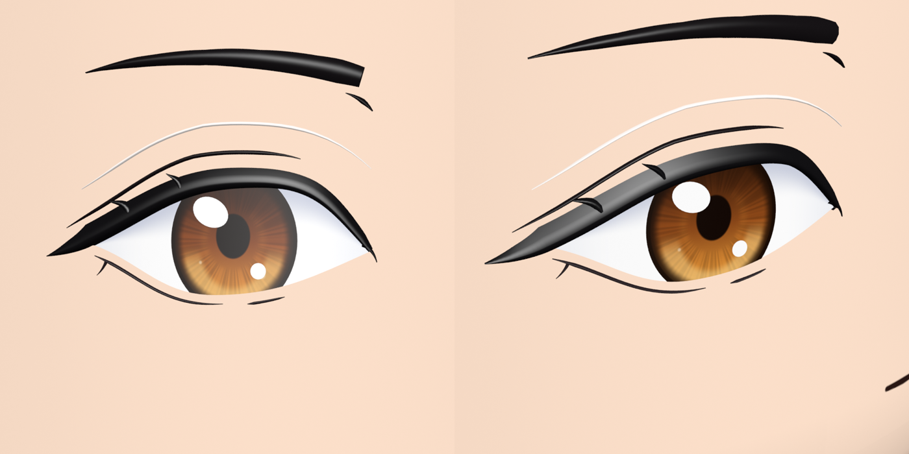
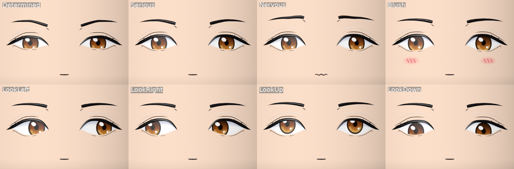
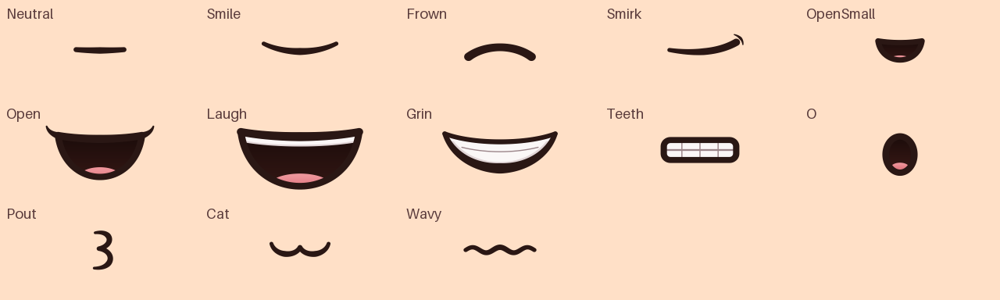
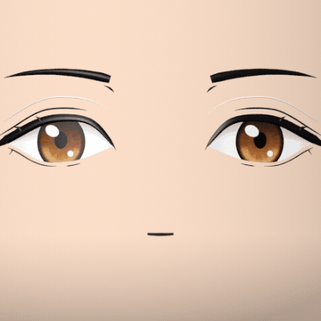

# AnimeFace R6: rigged 3D anime face for Roblox

An original anime-style male face built to fit the Roblox R6 head exactly. It follows the
structure of the supplied example face:

- The skin around the eyes stays flush with the head, and the eye white and iris sit on the skin.
- The black lash line is a glossy raised 3D ridge with a tapering outer wing and curved lash spikes.
- Separate thin raised lines sit apart from the eye: a dark crease, a pale highlight line above it,
  and lower lashes.
- Thick black brows, a warm brown gradient iris with white highlights, and swappable 2D mouth drawings.

Everything is driven by 38 bones, so it can be keyframed in the Animation Editor or by the included
controller (blinking, eye movement, 24 expressions, lip-flap talking, blush).







## The 2D mouth

The mouth is 13 flat images: Neutral, Smile, Frown, Smirk, OpenSmall, Open, Laugh, Grin, Teeth,
O, Pout, Cat and Wavy. They are drawn with thick dark-brown strokes, near-black insides, a pink
tongue and white teeth.

Each image is on its own small patch with its own bone (`Mouth_<Name>`). The visible image rests on
the skin, and the others wait just inside the head. Swapping an image means sliding one bone out and
the other in, so it's an instant texture swap that works the same from scripts and from Animation
Editor keyframes. The parent `Mouth` bone moves whichever image is showing.



Talking flips between OpenSmall, Open, O and Teeth, with the expression's own mouth between
syllables:



## What's in the box

| Path | What it is |
| --- | --- |
| `assets/AnimeFace.fbx` | Roblox-ready skinned mesh + armature (import this) |
| `assets/AnimeFace.glb` | Same rig as glTF, if you prefer that importer path |
| `assets/AnimeFace.blend` | Blender 4.5 source. The `FaceExpressions` action holds every preset (one per 10 frames, named markers) |
| `assets/textures/AnimeFace_Color.png` | 1024² colour atlas for a SurfaceAppearance (`AlphaMode = Overlay`; transparent = skin) |
| `assets/textures/AnimeFace_Color_Opaque.png` | Same art with a skin tone baked in, for `MeshPart.TextureID` |
| `assets/textures/AnimeFace_Roughness.png` | Roughness map (the lash ridges are glossy, the skin is matte) |
| `assets/textures/mouths/` | Each mouth image as its own transparent PNG (also usable as Decals) |
| `assets/AnimeFace_Scripts.rbxm` | The three scripts below, ready to drag into Studio |
| `roblox/` | Script sources: `AnimeFace` module (+ generated `Presets`), `FaceSetup` server script, `FaceClient` local script |
| `tools/` | The generator: geometry, texture painter, Blender build/export, previews, checks |
| `tests/controller.test.luau` | Offline controller tests (Lune) |

Specs: 16,564 triangles (Roblox limit 20,000), 38 bones, at most 4 influences per vertex, no
weights on the root bone, one material. The head shell was measured from the supplied R6
mannequin (a rounded cylinder: radius 0.6012, height 1.2024, edge radius 0.3006 studs) and wraps it
0.0008 studs larger. The raised lines stand 0.003 to 0.015 studs proud of the skin.

## Setting it up in Roblox Studio

1. **Import the mesh.** File → Import 3D → `assets/AnimeFace.fbx`. Use *Scale Unit: Stud*,
   *World Forward: Front*, *World Up: Top* (Roblox's documented Blender settings; the FBX is exported
   with FBX Unit Scale, Forward Z, Up Y). The file dimensions should read about 1.20 × 1.21 × 1.20.
2. **Name and store it.** Rename the imported model to `AnimeFaceModel` and move it to
   `ReplicatedStorage`.
3. **Texture.** Inside the face MeshPart, add a `SurfaceAppearance`. Set `ColorMap` to the uploaded
   `AnimeFace_Color.png`, `RoughnessMap` to `AnimeFace_Roughness.png`, and `AlphaMode` to
   `Overlay`. Transparent areas of the atlas then show the MeshPart's `Color`, which the scripts set
   to the avatar's head colour, so the face always matches the skin. Simpler alternative: set
   `MeshPart.TextureID` to `AnimeFace_Color_Opaque.png` (fixed skin tone).
4. **Scripts.** Insert `assets/AnimeFace_Scripts.rbxm` and move `AnimeFace` → `ReplicatedStorage`,
   `FaceSetup` → `ServerScriptService`, `FaceClient` → `StarterPlayer › StarterPlayerScripts`.
5. **Play.** Every character gets the face on its Head (the original head mesh and face decal are
   hidden). Demo keys: `,` / `.` cycle expressions, `M` cycles the mouth images (then back to
   automatic), `/` toggles blush, and chatting moves the mouth. Set `DEMO_KEYS = false` in
   `FaceClient` to remove the keys.

The face is joined to the Head with a `Motor6D` named `AnimeFaceJoint`. The scripts calibrate
from the bones' rest positions, so the mounting and the expression offsets stay correct even if
the importer flips or rotates the model's axes.

## Using it from your code

```lua
local AnimeFace = require(game.ReplicatedStorage.AnimeFace)

-- server: state replicates to every client through attributes on the face
AnimeFace.setExpression(character, "Happy")   -- any name from Presets.ExpressionOrder
AnimeFace.setMouth(character, "Grin")          -- force one 2D mouth image; nil = follow the expression
AnimeFace.setBlush(character, 1)               -- 0..1
AnimeFace.talk(character, "Nice to meet you!") -- mouth flaps for about as long as the line takes
AnimeFace.setLook(character, 0.6, 0)           -- -1..1, nil to release
AnimeFace.setManual(character, true)           -- hand the bones to your own animations

-- client: the FaceClient script already creates these; direct control is available too
local ctrl = AnimeFace.new(character.AnimeFace)
ctrl:SetExpression("Smug", 0.25)  -- optional fade time for eyes and brows (mouth images swap instantly)
ctrl:SetMouth("O")                -- ctrl:GetMouths() lists the images
ctrl:Blink()
ctrl:LookAt(workspace.CurrentCamera.CFrame.Position)
ctrl:Talk(2)                      -- seconds or text
ctrl:SetEyesClosed(1)             -- sleeping
ctrl:SetEnabled(false)
```

Expressions: Neutral, Blink, Smile, Happy, Laugh, Grin, Angry, Sad, Surprised, Shocked, Sleepy,
Smug, Determined, Serious, Shy, Nervous, Playful, Wink, Pout, Blush, LookLeft, LookRight, LookUp,
LookDown. Each expression picks one of the mouth images. Bone transforms are local to each client
(like any procedural animation), which is why the server sets attributes and each client animates
the faces it sees.

## Animating by hand

The bones appear under `Head › AnimeFace` in the Animation Editor. Move them in **Local** space
(Ctrl+L): eye and lid bones are oriented along the curved head surface. Set
`AnimeFace.setManual(character, true)` while your face animation plays so the procedural
controller doesn't overwrite it.

**Looking around:** `Iris_L` and `Iris_R` pivot at the centre of the head, like eyeballs. Rotate
them around their up axis to look left or right, so the iris slides along the curved head and
under the lids without lifting off. Move them straight up or down to look up or down. About 4°
is a full side glance.

**Swapping mouth images:** `Mouth_Neutral` is out at rest. To show another image, move its bone
**0.03 studs** straight out of the face and move `Mouth_Neutral` 0.03 studs in. Key those two bones
with **Constant** easing so the swap happens on one frame, as in the demo above. Only one image
should be out at a time.

| Bones | What they do |
| --- | --- |
| `FaceRoot` | Rig root (no skin weights) |
| `FaceBase` | Whole head shell and face |
| `Eye_L/R` | Whole eye (white, lids, lashes, crease) |
| `Iris_L/R` | Look direction (rotate = sideways, move = up/down); carries the highlights |
| `Shine_L/R` | The highlights on their own |
| `LidUpperInner_*`, `LidUpper_*`, `LidUpperOuter_*` | Upper lid and lash ridge: move down to close, tilt inner/outer for angry/sad shapes |
| `LidLower_L/R` | Lower lid and lower lashes: up for smiling or squinting eyes |
| `Brow_L/R`, `BrowInner_*`, `BrowOuter_*` | Whole brow and its two ends (the pale lid line follows the brow a little) |
| `Mouth` | Moves whichever mouth image is showing |
| `Mouth_<Name>` (13) | One per mouth image: 0.03 studs out = shown (Neutral: 0 = shown, 0.03 in = hidden) |
| `Blush_L/R` | Hidden inside the head at rest; slide 0.03 studs outward to show |

The lids use smooth weights, so a lid bone moves further than the lid line itself (closing the eye
takes about 0.13 studs on `LidUpper`). The `Blink` pose in the Blender file is a good reference.

## Changing the design

Shapes, layout, line widths and heights are parameters in `tools/face_design.py`. Colours and
drawings are in `tools/paint_atlas.py`: the eye colour is the `iris_*` palette entries, and the
mouth images are the `m_*` drawing functions. Expressions and their mouth choices live in
`tools/face_presets.py`. Closed-eye poses are solved from the skin weights, so blinks stay fully
closed if you reshape the eyes. Rebuild with:

```sh
python3 tools/paint_atlas.py                     # textures + mouth PNGs
blender -b --python tools/build_blend.py         # .blend, .fbx, .glb (Blender 4.5)
python3 tools/export_luau.py                     # roblox/AnimeFace/Presets.lua
lune run tools/build_rbxm.luau                   # assets/AnimeFace_Scripts.rbxm
python3 tools/check_mesh.py                      # triangle / influence / weight checks
blender -b --python tools/verify_export.py       # FBX + GLB round-trip, pose by pose
lune run tests/controller.test.luau              # controller tests
blender -b assets/AnimeFace.blend --python tools/render_preview.py -- sheet out/  # previews (also: look, anim)
blender -b --python tools/heightmap.py -- some_face.obj out/face               # surface height map of any face mesh
```

## Verification

- Mesh checks: under the triangle limit, ≤ 4 influences, normalised weights, no root weights, no
  zero-area faces.
- Export round-trip: the FBX and GLB re-import with all 38 bones, the same hierarchy, UVs,
  custom normals and embedded texture. Posing them (Neutral, Blink, Laugh, Angry, Shy, LookLeft,
  LookUp, Smug) matches the source rig within 4 × 10⁻⁷ studs.
- Controller: 944 checks against a fake imported rig with flipped axes and random bone
  orientations. They cover:
  - every expression moving every bone by the intended amount (largest error about 1.2 × 10⁻⁵
    studs, float32 noise);
  - the irises staying on the head surface while looking sideways;
  - exactly one mouth image out at a time, swapping on the next frame, through `SetMouth` and while
    talking;
  - blink, look, blush, enable/disable, and mounting onto the Head.
- Previews shade each surface from its normals, the lights and the roughness map, like Roblox does,
  rather than path tracing.

Not verified here: the import inside Roblox Studio itself (Studio can't run in this environment).
