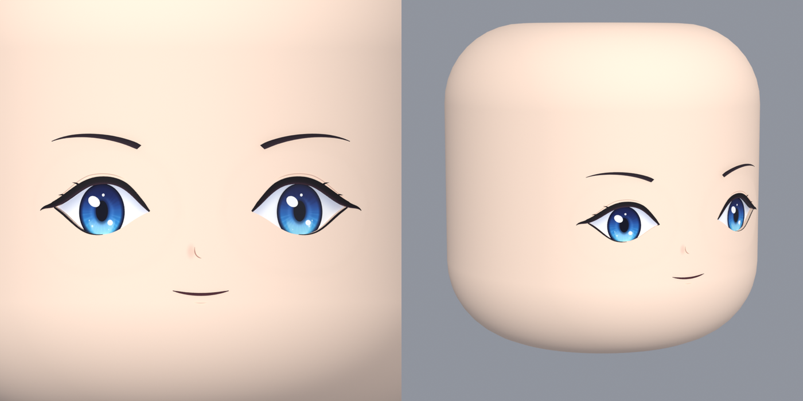
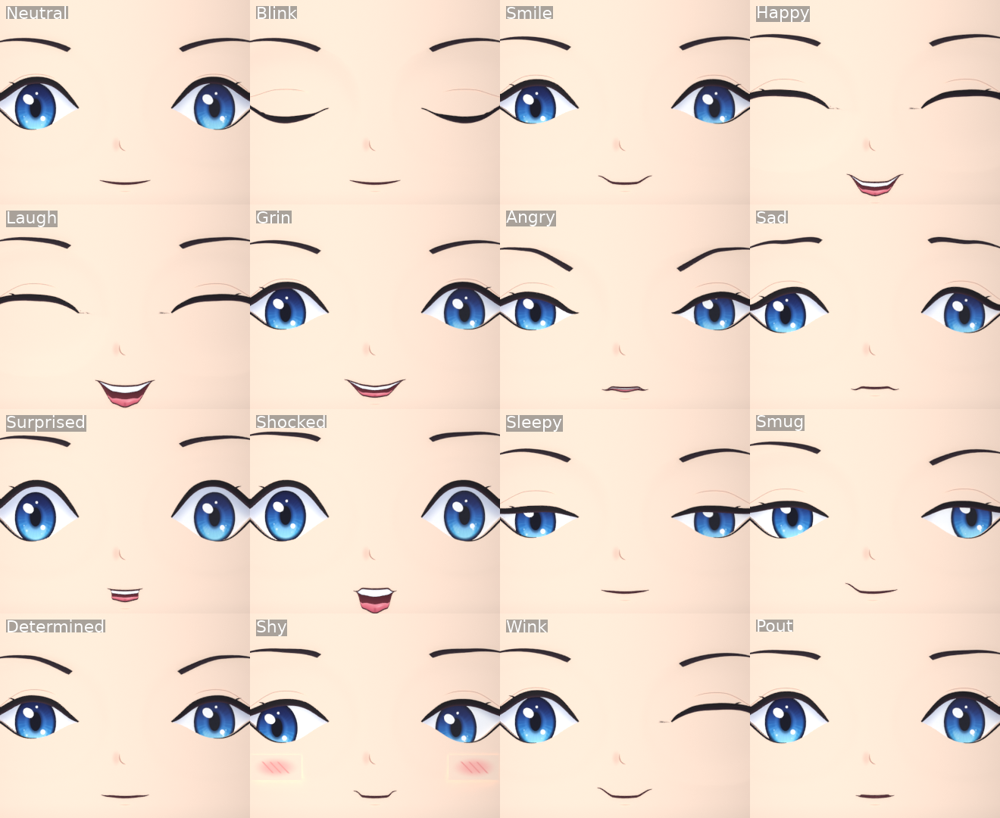
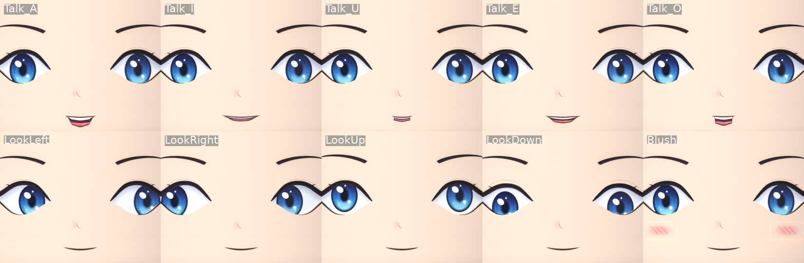
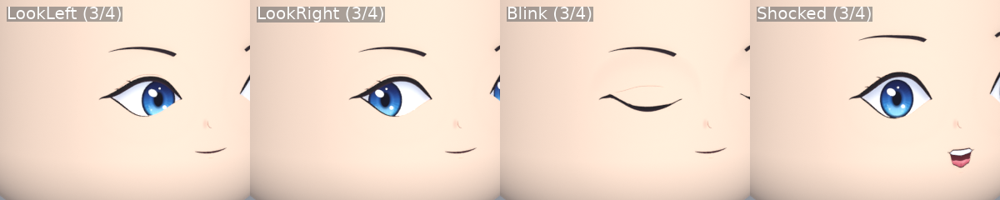

# AnimeFace R6 — rigged 3D anime face for Roblox

An original anime-style 3D face built to fit the Roblox R6 head exactly. Flat, layered eyes
(white, painted iris, highlight shapes), lash lines, brows, a nose and a 2D-style mouth with teeth
and tongue are real geometry on a single skinned mesh, driven by 34 bones. A Luau controller adds
blinking, eye movement, 26 expressions, lip-flap talking and blush, and every bone can also be
keyframed in the Animation Editor.







## What's in the box

| Path | What it is |
| --- | --- |
| `assets/AnimeFace.fbx` | Roblox-ready skinned mesh + armature (import this) |
| `assets/AnimeFace.glb` | Same rig as glTF, if you prefer that importer path |
| `assets/AnimeFace.blend` | Blender 4.5 source. The `FaceExpressions` action holds every preset (one per 10 frames, named markers) |
| `assets/textures/AnimeFace_Color.png` | 1024² colour atlas for a SurfaceAppearance (`AlphaMode = Overlay`; transparent = skin) |
| `assets/textures/AnimeFace_Color_Opaque.png` | Same art with a skin tone baked in, for `MeshPart.TextureID` |
| `assets/textures/AnimeFace_Roughness.png` | Optional roughness map |
| `assets/AnimeFace_Scripts.rbxm` | The three scripts below, ready to drag into Studio |
| `roblox/` | Script sources: `AnimeFace` module (+ generated `Presets`), `FaceSetup` server script, `FaceClient` local script |
| `tools/` | The generator: geometry, texture painter, Blender build/export, previews, checks |
| `tests/controller.test.luau` | Offline controller tests (Lune) |

Specs: 15,728 triangles (Roblox limit 20,000), 34 bones, at most 4 influences per vertex, no
weights on the root bone, one material. The head shell was measured from the supplied R6
mannequin (a rounded cylinder: radius 0.6012, height 1.2024, edge radius 0.3006 studs) and wraps it
0.0008 studs larger, so the mesh is 1.204 × 1.204 × 1.212 studs (the extra depth is the eyes and
lashes at the front).

## Setting it up in Roblox Studio

1. **Import the mesh.** File → Import 3D → `assets/AnimeFace.fbx`. Use *Scale Unit: Stud*,
   *World Forward: Front*, *World Up: Top* (Roblox's documented Blender settings; the FBX is exported
   with FBX Unit Scale, Forward Z, Up Y). The file dimensions should read about 1.20 × 1.21 × 1.20.
2. **Name and store it.** Rename the imported model to `AnimeFaceModel` and move it to
   `ReplicatedStorage`.
3. **Texture.** Inside the face MeshPart, add a `SurfaceAppearance`, set `ColorMap` to the uploaded
   `AnimeFace_Color.png` and `AlphaMode` to `Overlay` (optionally `RoughnessMap` too). Transparent
   areas of the atlas then show the MeshPart's `Color`, which the scripts set to the avatar's head
   colour, so the face always matches the skin. Simpler alternative: set `MeshPart.TextureID` to
   `AnimeFace_Color_Opaque.png` (fixed skin tone).
4. **Scripts.** Insert `assets/AnimeFace_Scripts.rbxm` and move `AnimeFace` → `ReplicatedStorage`,
   `FaceSetup` → `ServerScriptService`, `FaceClient` → `StarterPlayer › StarterPlayerScripts`.
5. **Play.** Every character gets the face on its Head (the original head mesh and face decal are
   hidden). Press `,` / `.` to cycle expressions and `/` to toggle blush (demo keys, set
   `DEMO_KEYS = false` in `FaceClient` to remove), and chat to see the mouth move.

The face is joined to the Head with a `Motor6D` named `AnimeFaceJoint`. The scripts calibrate
from the bones' rest positions, so the mounting and the expression offsets stay correct even if
the importer flips or rotates the model's axes.

## Using it from your code

```lua
local AnimeFace = require(game.ReplicatedStorage.AnimeFace)

-- server: state replicates to every client through attributes on the face
AnimeFace.setExpression(character, "Happy")   -- any name from Presets.ExpressionOrder
AnimeFace.setBlush(character, 1)               -- 0..1
AnimeFace.talk(character, "Nice to meet you!") -- mouth moves for about as long as the line takes
AnimeFace.setLook(character, 0.6, 0)           -- -1..1, nil to release
AnimeFace.setManual(character, true)           -- hand the bones to your own animations

-- client: the FaceClient script already creates these; direct control is available too
local ctrl = AnimeFace.new(character.AnimeFace)
ctrl:SetExpression("Smug", 0.25)  -- optional fade time
ctrl:Blink()
ctrl:LookAt(workspace.CurrentCamera.CFrame.Position)
ctrl:Talk(2)                      -- seconds or text
ctrl:SetEyesClosed(1)             -- sleeping
ctrl:SetEnabled(false)
```

Expressions: Neutral, Blink, Smile, Happy, Laugh, Grin, Angry, Sad, Surprised, Shocked, Sleepy,
Smug, Determined, Shy, Wink, Pout, Blush, talking visemes Talk_A/I/U/E/O, and LookLeft/Right/Up/Down.
Bone transforms are local to each client (like any procedural animation), which is why the server
sets attributes and each client animates the faces it sees.

## Animating by hand

The bones appear under `Head › AnimeFace` in the Animation Editor. Move them in **Local** space
(Ctrl+L): eye and lid bones are oriented along the curved head surface. Set
`AnimeFace.setManual(character, true)` while your face animation plays so the procedural
controller doesn't overwrite it.

| Bones | What they do |
| --- | --- |
| `FaceRoot` | Rig root (no skin weights) |
| `FaceBase` | Whole head shell and face |
| `Eye_L/R` | Whole eye |
| `Iris_L/R`, `Shine_L/R` | Look direction (iris + pupil + highlights); highlights alone |
| `LidUpperInner_*`, `LidUpper_*`, `LidUpperOuter_*` | Upper lid curve: move down to close, tilt inner/outer for angry/sad shapes |
| `LidLower_L/R` | Lower lid: up for smiling or squinting eyes |
| `Brow_L/R`, `BrowInner_*`, `BrowOuter_*` | Whole brow and its two ends |
| `Mouth` | Whole mouth |
| `MouthCorner_L/R` | Smile, frown, wide or narrow |
| `LipUpper` (+`_L/_R`) | Upper lip line and teeth |
| `LipLower` (+`_L/_R`) | Jaw opening and lower lip shape (the `_L/_R` children round it) |
| `Nose` | Nose line |
| `Blush_L/R` | Hidden inside the head at rest; slide outward about 0.027 studs to show |

The lids use smooth weights, so a lid bone moves further than the lid line itself (closing the eye
takes about 0.21 studs on `LidUpper`). The `Blink` pose in the Blender file is a good reference.

## Changing the design

Shapes, layout, colours and layer depths are parameters in `tools/face_design.py` and
`tools/paint_atlas.py`. Expressions live in `tools/face_presets.py` (closed-eye poses are solved
from the skin weights, so blinks stay fully closed if you reshape the eyes). Rebuild with:

```sh
python3 tools/paint_atlas.py                     # textures
blender -b --python tools/build_blend.py         # .blend, .fbx, .glb (Blender 4.5)
python3 tools/export_luau.py                     # roblox/AnimeFace/Presets.lua
lune run tools/build_rbxm.luau                   # assets/AnimeFace_Scripts.rbxm
python3 tools/check_mesh.py                      # triangle / influence / weight checks
blender -b --python tools/verify_export.py       # FBX + GLB round-trip, pose by pose
lune run tests/controller.test.luau              # controller tests
blender -b assets/AnimeFace.blend --python tools/render_preview.py -- sheet out/  # previews
```

## Verification

- Mesh checks: under the triangle limit, ≤ 4 influences, normalised weights, no root weights, no
  zero-area faces.
- Export round-trip: the FBX and GLB re-import with all 34 bones, the same hierarchy, UVs,
  custom normals and embedded texture. Posing them (Neutral, Blink, Laugh, Angry, Shy,
  LookLeft) matches the source rig within 3 × 10⁻⁷ studs.
- Controller: 736 checks against a fake imported rig with flipped axes and random bone
  orientations. Every expression moves every bone by the intended amount (largest error
  1.2 × 10⁻⁵ studs, float32 noise), plus blink, look, blush, talk, enable/disable and mounting
  onto the Head.
- Stress renders: full side glances and closed eyes from a three-quarter angle, where layering
  mistakes would show.



Not verified here: the import inside Roblox Studio itself (Studio can't run in this environment).
Previews are path-traced in Blender. The faint outline around the blush in them comes from that
renderer at the edge of the floating blush layer; the face doesn't cast shadows on itself in Roblox
and both sides of that edge shade identically, so it shouldn't appear in-game, but that's
unconfirmed.
